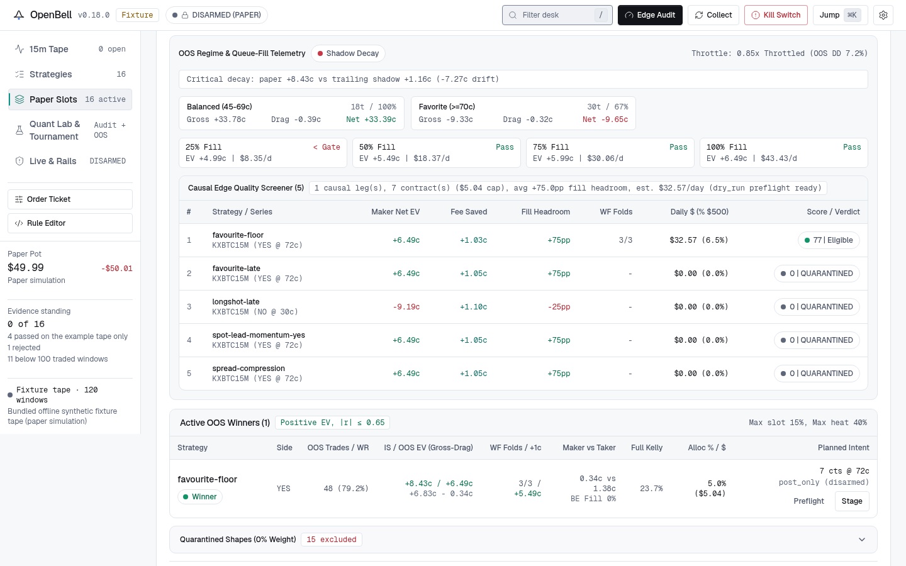
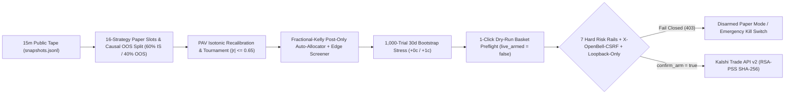

# OpenBell


**A high-speed Rust Kalshi Connected Trading & Quant Workbench for 15-minute markets** — pairing a fail-closed RSA-PSS Kalshi Trade API v2 client (`live_armed: false` on every boot, 7 Hard Risk Rails, Emergency Kill Switch) with a deduplicating public 15m tape collector, 16-strategy paper slot simulator, causal Post-Only Maker Auto-Allocator with cross-asset (`BTC`/`ETH`/`SOL`/`XRP`/`DOGE`) correlation cluster guard & `Diversified Safe Basket`, Edge Quality Screener, 1,000-trial 30-day Bootstrap Tail-Risk Simulator, Zero-Config Strategy Leaderboard, and Paper Forward-Test Envelope Drift Monitor with 1-click safe rotation.

<picture>
  <source media="(prefers-color-scheme: dark)" srcset="docs/screenshots/hero-dark.png">
  <source media="(prefers-color-scheme: light)" srcset="docs/screenshots/hero-light.png">
  
</picture>

---

## Feature Gallery

<table>
  <tr>
    <td width="50%" valign="top">
      <strong>Causal Edge Quality Screener &amp; Basket Preflight</strong><br>
      <sub>Ranks strategies and dominant 15m Kalshi series by maker net expectancy, fee edge saved, break-even queue fill headroom, walk-forward fold consistency, and <code>$500/day</code> contribution share with 1-click dry-run basket preflight.</sub>
      <br><br>
      <picture>
        <source media="(prefers-color-scheme: dark)" srcset="docs/screenshots/screener-dark.png">
        <source media="(prefers-color-scheme: light)" srcset="docs/screenshots/screener-light.png">
        
      </picture>
    </td>
    <td width="50%" valign="top">
      <strong>30-Day Bootstrap Simulator &amp; Zero-Config Strategy Leaderboard</strong><br>
      <sub>Resamples 1,000 deterministic trajectories across 30 days (96 15m windows/day) under <code>+0c</code> and <code>+1c</code> adverse-fill slippage, ranks 6 calibrated presets (including <code>Diversified Safe Basket</code>) against a hard <code>0.0%</code> daily rail-breach gate, caps correlated cross-asset clusters, and exports Audit JSON in 1 click.</sub>
      <br><br>
      <picture>
        <source media="(prefers-color-scheme: dark)" srcset="docs/screenshots/stress-test-dark.png">
        <source media="(prefers-color-scheme: light)" srcset="docs/screenshots/stress-test-light.png">
        
      </picture>
    </td>
  </tr>
</table>

---

## Causal Execution & Fail-Closed Risk Pipeline



---

## Verified Benchmarks (`v0.18.0` vs `v0.10.0`)

Measured on a 102k-tick / 1,020 settled window 15-minute tape (`v0.10.0` baseline from cold `scale-audit`; `v0.18.0` measured post-edit on `:18445` under `taskset -c 24-31` with 14 workers):

| Metric | `v0.10.0` Baseline | `v0.18.0` Verified | Delta |
| --- | --- | --- | --- |
| Release binary size (`strip`, `lto = "fat"`) | `10.66 MB` (`11,179,360 B`) | **`5.90 MB`** (`6,186,336 B`) | **`-44.7%`** |
| Initial `GET /` shell (raw / gzip) | `1,152,017 B` / `423,382 B` | **`95,073 B`** / **`21,935 B`** (`21` `/chunks/*`) | **`-94.8%` wire bytes** |
| Cold boot to first `HTTP 200` (warmed median) | `9.11 ms` | **`4.18 ms`** | **`-54.1%`** |
| Peak RSS (`VmHWM`) after core / full analytics | `125.55 MB` (`128,560 KB`) | **`23.20 MB`** (`23,752 KB`) core / `26.62 MB` (`27,256 KB`) full | **`-81.5%` core** |
| Concurrent HTTP throughput | `4,921.3 req/s` (30w) | **`3,673.9 req/s`** (`3.56 ms` p50, `6.61 ms` p95, 14w, `0` err) | Clean (`0` err) |
| Test & mechanical verification | — | **`123/123` Rust tests**, `gate 101/101`, `replay 18/18`, `sloplint 0 FAIL/WARN`, `RAILS OK`, `EQUITY OK` | Clean |

---

## Quick Start (Synthetic Paper Mode — Zero Real Credentials)

```sh
# 1. Build frontend assets and release binary
cd frontend && npm run build && cd ..
cargo build --release --locked

# 2. Launch with synthetic/local paper data (always boots live_armed: false)
OPENBELL_DATA=./frontend/e2e/fixtures/data OPENBELL_COLLECT_SECS=3600 PORT=18440 ./target/release/openbell-rs
```

Open `http://127.0.0.1:18440/?dataset=fixture` to inspect the 15-minute fixture tape, Causal Edge Quality Screener, Stage Best Basket dry-run preflight, and 30-day Bootstrap Tail-Risk Simulator with zero live credentials or external orders.

---

## Architecture & Guardrails

### Fail-Closed Hard Risk Rails & Live Kalshi v2 (`src/risk_rails.rs`, `src/kalshi_live.rs`)
- **Disarmed by default (`live_armed: false`):** Every launch and restart boots disarmed. Routing an order requires configured Kalshi v2 API credentials (`0600` inside `OPENBELL_DATA`, never echoed or logged), explicit `confirm_arm: true` over loopback with `X-OpenBell-CSRF: 1`, and passing all 7 Hard Risk Rails (`max_order_contracts`, `max_order_dollars`, `max_daily_loss_dollars`, `max_open_exposure_dollars`, `allowed_ticker_prefix`, whole-cent `1..=99` price check, and kill-switch clear).
- **Emergency Kill Switch (`POST /api/live/kill-switch`):** Immediately disarms `live_armed`, latches `killed: true`, and issues `cancel_all_orders()`.
- **HTTP Hardening (`src/main.rs`):** Host-header loopback confinement (`403` on non-loopback), `Content-Type: application/json` enforcement (`415`), prompt raw-TCP `413 Payload Too Large` before allocation, `X-Content-Type-Options: nosniff`, `X-Frame-Options: DENY`, `Referrer-Policy: no-referrer`, strong SHA-256 `ETag` + `304`, and CWE-22/CWE-59 symlink/path confinement.

### Causal Paper Analytics & Slot Simulation
- **Zero-Lookahead OOS Split (`src/auto_allocator.rs`):** Chronological 60% In-Sample -> 40% Out-of-Sample evaluation; replay weights are frozen strictly from In-Sample windows whenever IS history is present.
- **Post-Only Maker Economics & Whole-Cent Accounting:** Models exact Kalshi maker fees (`0.0175 * p * (1 - p)`, `1/4` of taker `0.07 * p * (1 - p)`) rounded up to whole cents per order (`ceil(rate * C * p * (1 - p) * 100) / 100`).
- **16-Strategy Sandboxed Library (`strategies/*.rn`):** Includes `bid_ask_imbalance`, `favourite_floor`, `favourite_late`, `late_convergence_cap`, `longshot_late`, `maker_late_theta_no`, `maker_spread_capture`, `mean_reversion_fade`, `mid_window_momentum`, `no_favourite`, `opening_range_break`, `spot_lead_momentum_yes`, `spread_compression`, `tail_overreaction_fade`, `time_decay_harvest`, and `volatility_squeeze`.
- **Same-Site & Resource Diet:** Pre-gzipped `.rodata` assets (`index.html.gz` + 21 embedded `/chunks/*` routes) with pure-Rust RFC 1951/1952 `inflate_gzip` (`src/gzip_inflate.rs`) for `identity` HTTP clients, thread-local `Arc<str>` interning (`TapePoolGuard`), and GNU/Linux `mallopt(M_ARENA_MAX, 2)`.

### Verification Suite
- `cargo clippy --all-targets -- -D warnings`
- `cargo test` (`123` unit + integration tests across `analytics`, `auto_allocator`, `edge_audit`, `kalshi_live`, `recalibration`, `risk_rails`, `scaling`, `tournament`, `update`, and HTTP/SSE/CWE-59 suites)
- `cargo check --target x86_64-pc-windows-msvc`
- `bash .loop/checks/rails.sh && bash .loop/checks/equity.sh`
- `cd frontend && npm run check:ui -- --skip-build --lints` (`gate 101/101`, `replay 18/18`, Hallmark `sloplint --scope app --render`)

### Environment Variables (All Optional)

| Variable | Default |
| --- | --- |
| `OPENBELL_DATA` | `$XDG_DATA_HOME/openbell` or `./openbell-data` when present |
| `OPENBELL_STRATEGIES` | `strategies/` inside `OPENBELL_DATA` (or `./strategies`) |
| `OPENBELL_COLLECT_SECS` | `60` (collector freshness interval, `5..=3600`s) |
| `OPENBELL_AUTO_COLLECT` | `0` (`1` or `--auto-collect` starts the public 15m collector) |
| `OPENBELL_SERIES` | `KXBTC15M,KXETH15M,KXSOL15M,KXXRP15M,KXDOGE15M` |
| `OPENBELL_PAPER_POT` | `100` (paper simulation starting pot) |
| `OPENBELL_ALLOWED_HOSTS` | none (comma-separated extra hosts allowed past loopback guard) |
| `PORT` | `8472` (falls back across `8472..=8492` unless explicit `PORT` is set) |
| `OPENBELL_NO_OPEN` | unset (`1` or `--no-open` suppresses auto-opening browser) |
