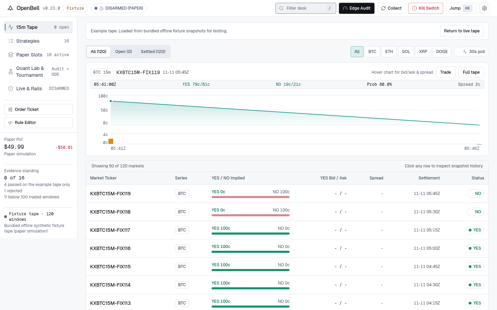
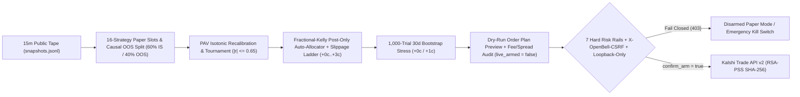

# OpenBell


OpenBell is a local Rust trading workbench for 15-minute Kalshi prediction markets. It pairs a Kalshi Trade API v2 client (`live_armed: false` on every boot, seven hard risk rails, and an emergency kill switch) with a deduplicating public 15-minute tape collector, a 16-strategy paper slot simulator, and a causal post-only maker allocator.

<picture>
  <source media="(prefers-color-scheme: dark)" srcset="docs/screenshots/hero-dark.png">
  <source media="(prefers-color-scheme: light)" srcset="docs/screenshots/hero-light.png">
  
</picture>

## Feature gallery

<table>
  <tr>
    <td width="50%" valign="top">
      <strong>Causal Edge Quality Screener &amp; Dry-Run Order Plan</strong><br>
      <sub>Ranks strategies and 15-minute Kalshi series by maker net expectancy, fee savings, break-even queue fill headroom, walk-forward fold consistency, and <code>$500/day</code> contribution share alongside per-leg whole-cent fee, spread-crossing, and minimum-fill dry-run verification.</sub>
      <br><br>
      <picture>
        <source media="(prefers-color-scheme: dark)" srcset="docs/screenshots/screener-dark.png">
        <source media="(prefers-color-scheme: light)" srcset="docs/screenshots/screener-light.png">
        
      </picture>
    </td>
    <td width="50%" valign="top">
      <strong>30-Day Bootstrap Simulator, Slippage Ladder &amp; Session Briefing</strong><br>
      <sub>Resamples 1,000 deterministic 30-day trajectories across 96 windows per day, measures causal degradation from <code>+0c</code> through <code>+3c</code> with break-even slippage cushion (<code>THIN &lt;1c</code>, <code>SAFE &gt;=2c</code>), validates Calm vs High-Vol regime stability, and checks every preset against a <code>0.0%</code> daily rail-breach gate.</sub>
      <br><br>
      <picture>
        <source media="(prefers-color-scheme: dark)" srcset="docs/screenshots/stress-test-dark.png">
        <source media="(prefers-color-scheme: light)" srcset="docs/screenshots/stress-test-light.png">
        
      </picture>
    </td>
  </tr>
</table>

## Causal execution and fail-closed risk pipeline



## Verified benchmarks (`v0.23.0` vs `v0.10.0`)

Measured on a 100k-tick, 2,000-window 15-minute tape via `scale-audit` under `#154` (`taskset -c 24-31`, 16 workers, 5 SSE subscribers, and 25 raw-TCP fuzz checks):

| Metric | `v0.10.0` Baseline | `v0.23.0` Verified | Delta |
| --- | --- | --- | --- |
| Release binary size (`strip`, `lto = "fat"`) | `10.66 MB` (`11,179,360 B`) | **`5.84 MiB`** (`6,124,896 B`) | **`-45.2%`** |
| Initial `GET /` shell (raw / gzip) | `1,152,017 B` / `423,382 B` | **`95,074 B`** / **`21,930 B`** (`21` `/chunks/*`) | **`-94.8%` wire bytes** |
| Cold boot to first `HTTP 200` | `9.11 ms` | **`6.17 ms`** | **`-32.3%`** |
| Peak RSS (`VmHWM`) | `125.55 MB` (`128,560 KB`) | **`17.52 MB`** (`17,944 KB`) | **`-86.0%`** |
| Concurrent HTTP throughput (16w, `5/5` SSE) | `4,921.3 req/s` (30w) | **`4,662.3 req/s`** (`3.19 ms` p50, `4.85 ms` p95, `0` errors) | **`3.96x` vs `1,178` v0.9.0** |
| Security and test verification | `49/49` fuzz | **`127/127` Rust tests**, `25/25` raw-TCP fuzz, `gate 101/101`, `replay 18/18`, `sloplint 0 FAIL/WARN`, `RAILS OK`, `EQUITY OK` | Clean |

## Quick start (synthetic paper mode)

```sh
# 1. Build frontend assets and release binary
cd frontend && npm run build && cd ..
cargo build --release --locked

# 2. Launch with synthetic/local paper data (always boots live_armed: false)
OPENBELL_DATA=./frontend/e2e/fixtures/data OPENBELL_COLLECT_SECS=3600 PORT=18440 ./target/release/openbell-rs
```

Open `http://127.0.0.1:18440/?dataset=fixture` to inspect the 15-minute fixture tape, causal edge screener, slippage sensitivity ladder, and 30-day bootstrap simulator without live credentials or external orders.

## Architecture and guardrails

### Fail-closed hard risk rails and live Kalshi v2 (`src/risk_rails.rs`, `src/kalshi_live.rs`)

Every launch and restart boots with `live_armed: false`. Routing an order requires configured Kalshi v2 API credentials stored with `0600` permissions inside `OPENBELL_DATA`, explicit `confirm_arm: true` over loopback with `X-OpenBell-CSRF: 1`, and passing all seven hard risk rails (`max_order_contracts`, `max_order_dollars`, `max_daily_loss_dollars`, `max_open_exposure_dollars`, `allowed_ticker_prefix`, whole-cent `1..=99` price check, and kill-switch clear). Posting to `POST /api/live/kill-switch` disarms `live_armed`, latches `killed: true`, and runs `cancel_all_orders()`.

HTTP requests enforce Host-header loopback confinement (`403` on non-loopback hosts), `Content-Type: application/json` (`415`), prompt raw-TCP `413 Payload Too Large` responses before allocation, `X-Content-Type-Options: nosniff`, `X-Frame-Options: DENY`, `Referrer-Policy: no-referrer`, strong SHA-256 `ETag` `304` handling, and CWE-22/CWE-59 symlink and path confinement.

### Causal paper analytics and slot simulation

The auto-allocator in `src/auto_allocator.rs` splits settled windows chronologically into 60% in-sample and 40% out-of-sample periods, freezes replay weights on in-sample data when in-sample history exists, enforces a correlated regime drawdown ceiling across both multi-asset and same-asset strategy clusters bounded by `max_daily_loss_dollars`, and models Kalshi maker fees (`0.0175 * p * (1 - p)`, one quarter of taker `0.07 * p * (1 - p)`) rounded up to whole cents per order (`ceil(rate * C * p * (1 - p) * 100) / 100`). Across `strategies/*.rn`, it runs 16 paper strategies (`bid_ask_imbalance`, `favourite_floor`, `favourite_late`, `late_convergence_cap`, `longshot_late`, `maker_late_theta_no`, `maker_spread_capture`, `mean_reversion_fade`, `mid_window_momentum`, `no_favourite`, `opening_range_break`, `spot_lead_momentum_yes`, `spread_compression`, `tail_overreaction_fade`, `time_decay_harvest`, and `volatility_squeeze`), partitions epochs into Calm and High-Vol regimes causally, and computes the `+0c` through `+3c` slippage ladder with break-even cushion status.

Static assets (`assets/index.html.gz` and 21 embedded `/chunks/*` routes) stay gzip-compressed in `.rodata` and inflate via pure-Rust RFC 1951/1952 `inflate_gzip` (`src/gzip_inflate.rs`) for `identity` HTTP clients, while `TapePoolGuard`, zero-capacity-trimmed market JSON, and `mallopt` bounds keep peak RSS under `18 MB`.

### Verification suite

- `cargo clippy --all-targets -- -D warnings`
- `cargo test` (`127` unit and integration tests across `analytics`, `auto_allocator`, `edge_audit`, `kalshi_live`, `recalibration`, `risk_rails`, `scaling`, `tournament`, `update`, and HTTP/SSE/CWE-59 suites)
- `cargo check --target x86_64-pc-windows-msvc`
- `bash .loop/checks/rails.sh && bash .loop/checks/equity.sh`
- `cd frontend && npm run check:ui -- --skip-build --lints` (`gate 101/101`, `replay 18/18`, Hallmark `sloplint --scope app --render`)

### Environment variables

| Variable | Default |
| --- | --- |
| `OPENBELL_DATA` | `$XDG_DATA_HOME/openbell` or `./openbell-data` when present |
| `OPENBELL_STRATEGIES` | `strategies/` inside `OPENBELL_DATA` (or `./strategies`) |
| `OPENBELL_COLLECT_SECS` | `60` (collector freshness interval, `5..=3600`s) |
| `OPENBELL_AUTO_COLLECT` | `0` (`1` or `--auto-collect` starts the public 15m collector) |
| `OPENBELL_SERIES` | `KXBTC15M,KXETH15M,KXSOL15M,KXXRP15M,KXDOGE15M` |
| `OPENBELL_PAPER_POT` | `100` (paper simulation starting pot) |
| `OPENBELL_ALLOWED_HOSTS` | none (comma-separated extra hosts allowed past loopback guard) |
| `PORT` | `8472` (falls back across `8472..=8492` unless explicit `PORT` is set) |
| `OPENBELL_NO_OPEN` | unset (`1` or `--no-open` suppresses auto-opening browser) |
